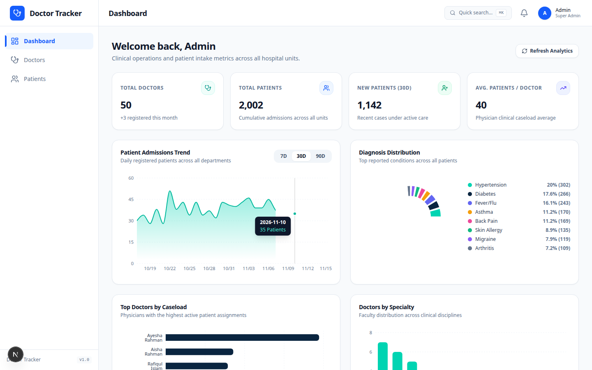
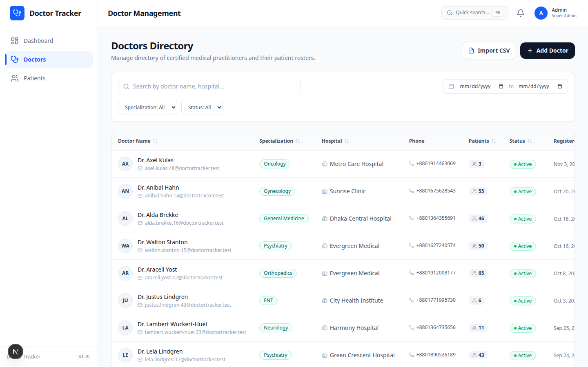
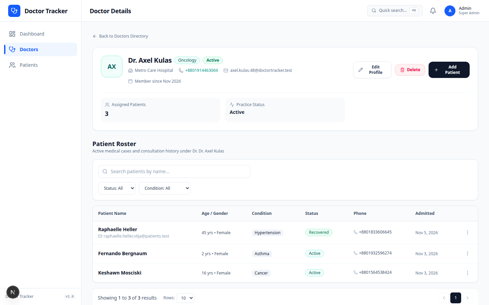
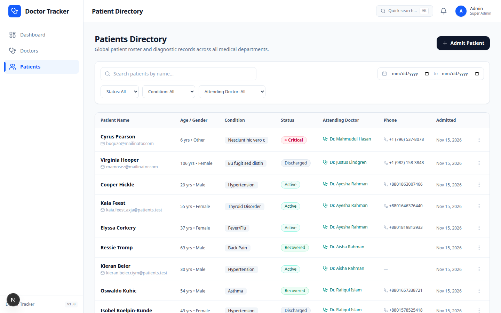
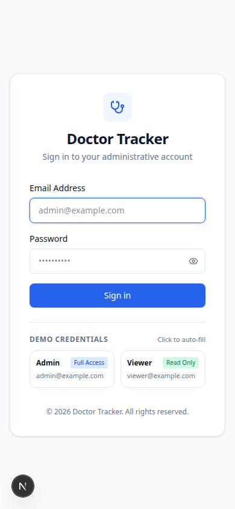
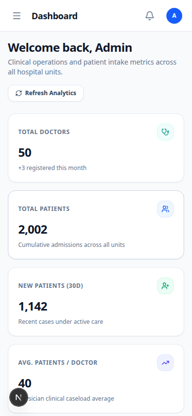
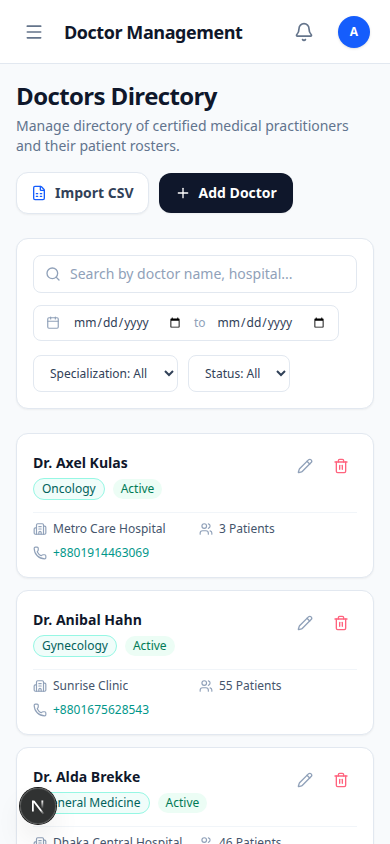
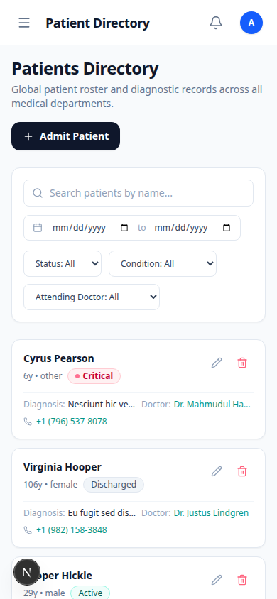

# Doctor Tracker — Frontend Application

## Description
Doctor Tracker is a modern, high-performance administrative web application designed for clinic and hospital management teams. The frontend client provides hospital administrators and medical staff with a polished, accessible, and responsive user experience to manage doctors and assigned patient rosters, inspect real-time clinical workload charts, and conduct fast server-side filtered queries with pagination. Built on Next.js 16 (App Router), React 19, Tailwind CSS, TanStack Query, and Recharts.

- **Frontend Repository:** https://github.com/shiplu2111/doctor-tracker-frontend
- **Backend API Repository:** https://github.com/shiplu2111/doctor-tracker-backend
- **Demo Credentials:**
  - Admin: `admin@example.com` / `ChangeMe-12345`
  - Viewer: `viewer@example.com` / `ChangeMe-12345`

---

## Features
- **Authentication & RBAC:** Secure session cookie authentication, route protection via Next.js Middleware, role-based permission gates (`admin`, `viewer`).
- **Doctor Management:** Full CRUD drawer modals, search, multi-filter (Specialization, Hospital, Status, Date), server-side pagination, and patient count tracking.
- **Patient Management:** Dedicated patient roster, instant inline edits, diagnosis and condition filtering, date-based admittance range filtering, and doctor reassignment.
- **Interactive Analytics Dashboard:** Real-time KPI summaries, dynamic patients-per-doctor distribution, 7d/30d/90d intake timeseries, and condition breakdown charts powered by Recharts.
- **Optimized UI/UX:** URL-synchronized query parameters (`useQueryParams`), viewport-aware portal action menus, zero-flicker debounced search, and responsive mobile card layouts.

---

## Tech Stack
- **Framework:** Next.js 16.4 (App Router) & React 19
- **State & Data Fetching:** TanStack Query v5, Zustand, URL Query Parameters
- **Styling & Components:** Tailwind CSS v4, Lucide React, Headless UI patterns
- **Data Visualization:** Recharts
- **Forms & Validation:** React Hook Form & Zod
- **Testing:** Vitest, React Testing Library, Playwright (E2E)

---

## Setup Guide

### Prerequisites
- Node.js 20+
- npm or pnpm
- Running Doctor Tracker Backend API (`http://localhost:4000/api/v1`)

### 1. Installation
```bash
git clone https://github.com/shiplu2111/doctor-tracker-frontend.git
cd doctor-tracker-frontend
npm install
```

### 2. Environment Configuration
Copy the provided `.env.example` file:
```bash
cp .env.example .env.local
```

Configure your environment variables:
```env
NEXT_PUBLIC_API_URL=http://localhost:4000/api/v1
BASE_URL=http://localhost:3000
```

### 3. Run Development Server
```bash
npm run dev
```
Open [http://localhost:3000](http://localhost:3000) in your browser.

### 4. Available Scripts
| Command | Description |
|---|---|
| `npm run dev` | Start development server with Turbopack on port 3000 |
| `npm run build` | Compile optimized production build |
| `npm run start` | Start production server |
| `npm run lint` | Run ESLint check |
| `npm test` | Run unit and component test suite (Vitest) |
| `npm run test:e2e` | Run Playwright end-to-end tests across flows |

---

## System Architecture

```
┌────────────────────────────────────────────────────────┐
│                   Next.js 16 Client                    │
├─────────────────┬────────────────────┬─────────────────┤
│  App Router     │  TanStack Query    │  Zustand Store  │
│  (Pages & Auth) │  (Server State)    │  (Client Auth)  │
└────────┬────────┴─────────┬──────────┴────────┬────────┘
         │                  │                   │
         ▼                  ▼                   ▼
┌────────────────────────────────────────────────────────┐
│               REST API Client Layer                    │
│   (Credentialed fetch with auto-refresh on 401)        │
└───────────────────────────┬────────────────────────────┘
                            │ HTTPS (httpOnly cookies)
                            ▼
┌────────────────────────────────────────────────────────┐
│              Doctor Tracker Backend API                │
│             (Node.js / Express / MongoDB)              │
└────────────────────────────────────────────────────────┘
```

---

## Technical Decisions

### 1. TanStack Query & URL Query Parameters over Redux
- **Context:** The application consists predominantly of server-driven clinical datasets (lists, metrics, aggregate charts, filtered sets) rather than complex transient client state.
- **Decision:** Utilize TanStack React Query for all server data caching and synchronization, combined with URL query parameters as the single source of truth for active filters, sorting, search, and pagination.
- **Why:** Avoids boilerplate and synchronizing issues associated with storing API responses in Redux. Automatically handles cache invalidation, background refetching, and window focus revalidation. Query-in-URL enables shareable links, back/forward navigation support, and page reload persistence.

### 2. Viewport-Aware Portaled Table Action Menus
- **Context:** Table rows within overflow-scrollable table containers caused traditional absolute dropdown menus on lower rows to be clipped by container boundaries and horizontal scrollbars.
- **Decision:** Created a lightweight, portaled action menu (`TableActionMenu`) rendered directly to `document.body` with dynamic bounding rect calculations.
- **Why:** Completely eliminates boundary clipping while maintaining full responsive layout. If available space beneath the button is limited (< 190px), the menu automatically flips upward (dropup).

---

## Visual Evidence

### Desktop Views (1440x900)
| Dashboard Overview | Doctors Directory |
|---|---|
|  |  |
| **Doctor Detail & Patient Roster** | **Patient Directory** |
|  |  |

### Mobile Views (390x844)
| Mobile Login | Mobile Dashboard | Mobile Doctors | Mobile Patients |
|:---:|:---:|:---:|:---:|
|  |  |  |  |
